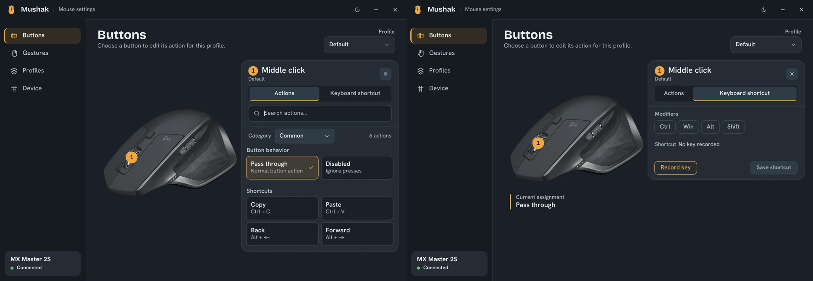
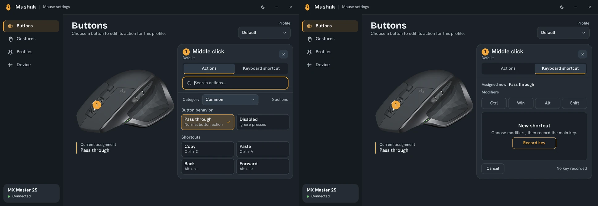

# Keyboard shortcut editor sizing

At commit `fc55511`, clicking **Keyboard shortcut** in the Middle click editor narrowed the Actions tab from 166 to 85 logical pixels. The panel shrank from 454 to 282 pixels and the mouse marker moved up 34 pixels. At 720 × 540, entering a search term moved the input down 98 pixels.

The editor now divides the tab strip equally. At 968 × 668, both tabs measure 166 logical pixels wide, and switching between them keeps the 436-pixel panel and the mouse marker in place. Search results can use less height below the search box. The box stays under the pointer.

## Before and after

Each image shows Actions on the left and Keyboard shortcut on the right. These are app captures with an isolated, simulated MX Master 2S. The standard window uses 968 × 668 logical pixels at 200% display scale.

**Before**

**After**

## Interaction checks

The GPU check opens the mapping editor, filters the action list, switches tabs, starts and cancels recording, and measures the controls' bounds across those transitions. It also cancels an edited modifier and checks that the saved mapping survives. The broader suite sends a key event to the test window, saves the shortcut, and reopens it. Run `cargo run --locked -- --ui-smoke` on Windows. The test writes only to its sample settings directory.

The review also caught clipped multi-key shortcuts and a wrapping category selector. The compact editor now uses the same categories as the diagram editor. Tab commands have their own category, and the picker only offers Save once there is a recorded shortcut.

## Independent visual review

The rows below cover the four interaction groups in this follow-up. The 38-group gallery in the parent directory records the earlier redesign. Each reviewer independently saw four rendered states for each group. The models scored Overall separately and did not receive earlier scores, others' votes or the target score.

| Group | gpt-6.2-sol | gpt-6.1-sol | gpt-6.1-terra | Median Overall |
|---|---:|---:|---:|---:|
| Middle click, light | 8 | 9 | 8 | 8 |
| Middle click, dark | 8 | 9 | 8 | 8 |
| Thumb button, dark | 9 | 9 | 8 | 9 |
| Compact list, dark | 8 | 9 | 8 | 8 |

[All eight scores from each reviewer and round](scores.csv)

[Middle click, light](light.webp) · [Middle click, dark](dark.webp) · [Thumb button](thumb.webp) · [Compact list](compact.webp)

The captures and event checks exercise software behavior. Physical mouse input was outside this sizing check.
